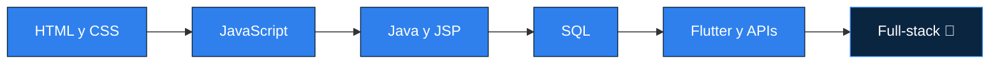

)

---

## 👨‍💻 Sobre mí

Soy **Raúl**, de Barcelona, y estudio el Grado Superior de **Desarrollo de Aplicaciones Web (DAW)**. Me apasiona aprender cómo se construye el software de principio a fin: desde el modelo de datos hasta la interfaz que ve el usuario.

- 🔭 Ahora mismo estoy aprendiendo **Java, SQL, XML, JavaScript y Flutter**
- 🌱 Quiero formarme al máximo y seguir creciendo con cada proyecto
- 🤝 Tengo muchas ganas de **formar parte de proyectos reales** y aprender trabajando en equipo
- 🎯 Mi meta: convertirme en programador **full-stack**

---

## 🛠️ Lenguajes y herramientas

  

| Área | Tecnologías |
|------|-------------|
| ☕ **Backend** | Java, JSP, SQL, APIs, JSON |
| 🎨 **Frontend** | HTML, CSS, JavaScript, Flutter |
| 📄 **Lenguajes de marcas** | XML, XSD, Markdown |
| 🧪 **Calidad** | jUnit |
| 📐 **Diseño y análisis** | Diagramas de comportamiento y de relación |
| 🔧 **Herramientas** | Git, GitHub, Trello |

---

## 🗺️ Mi ruta de aprendizaje

---

## 🎯 Objetivos

- [x] Aprender la base de Java y lenguajes de marcas
- [x] Crear mi perfil de GitHub
- [ ] Publicar mi primer proyecto full-stack

---

## 📚 Mis repositorios

| Repositorio | Qué contiene |
|-------------|--------------|
| [PROGRAMACION-DAW](https://github.com/raulabad-DAW/PROGRAMACION-DAW) | Mis prácticas y ejercicios de las asignaturas del ciclo DAW |
| [ENTORNOS-DESARROLLO-KRAKEN](https://github.com/raulabad-DAW/ENTORNOS-DESARROLLO-KRAKEN) | Pruebas para practicar Git con GitKraken |

---

## 🔥 Mis estadísticas

---

⭐ *¿Tienes un proyecto y buscas a alguien con ganas de aprender y aportar? ¡Hablamos!*

